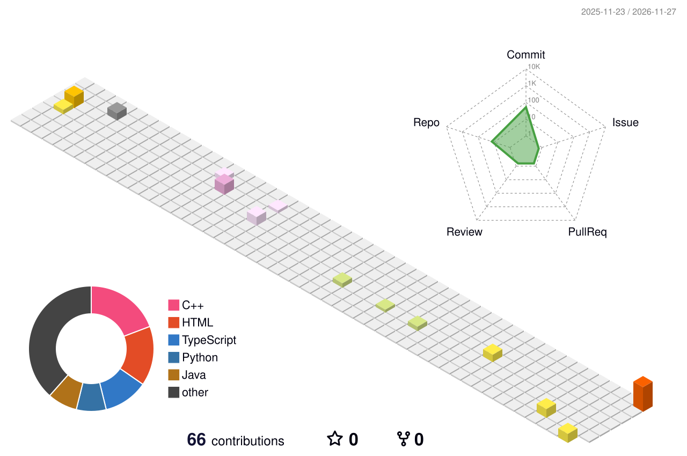
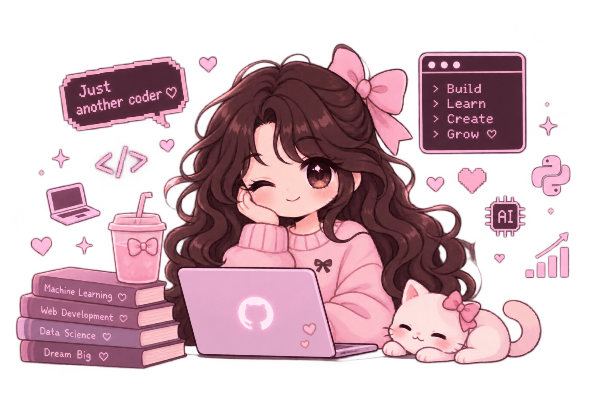

<!-- HEADER -->

 

---

 ## 🌷 About Me

Hi! I'm **Namratha Vanka**, a third-year B.Tech student specializing in Artificial Intelligence and Machine Learning, passionate about building intelligent applications and scalable software solutions.

I enjoy combining AI/ML concepts with software engineering to turn ideas into practical, real-world applications. My interests span applied machine learning, full-stack development, and emerging AI technologies.

- 🤖 Exploring Machine Learning, Deep Learning, LLMs, RAG and AI Agents.
- 💻 Developing full-stack applications and AI-powered solutions.
- 🧩 Strengthening problem-solving skills through Data Structures and Algorithms.
- 🔬 Interested in applied AI research, innovation and experimentation.
- 🚀 Constantly building projects, exploring technologies and expanding my technical skills.

**My philosophy:** Build with curiosity. Learn with consistency. Create with purpose.

---

## 🛠️ Tech Stack

### Programming Languages

  

### Web Development & Databases

  

### AI / ML Ecosystem

  

  <code>Scikit-learn</code> · <code>XGBoost</code> · <code>Pandas</code> · <code>NumPy</code> · <code>MediaPipe</code> · <code>Streamlit</code> · <code>RAG</code> · <code>LLMs</code>

### Tools & Technologies

  

---

## 🚀 Featured Projects

### 🤖 AI RPG Dungeon Master

An ML-powered interactive role-playing game that dynamically adapts quests, NPC behaviour and world state based on player interactions.

- Intent classification and sentiment analysis.
- Dynamic world-state and NPC behaviour management.
- Player archetype clustering using K-Means.
- Adaptive quest recommendations.

**Stack:** Python · Streamlit · Scikit-learn · XGBoost · Pandas

[🚀 Live Demo](https://ai-rpg-dungeon-master.streamlit.app/)

---

### 🖐️ SIGNLink AI

A real-time sign language recognition application that translates hand gestures into text and voice output.

- Hand landmark detection using MediaPipe.
- Processing of 21 hand landmarks.
- Gesture classification.
- Responsive React-based interface.

**Stack:** React · TypeScript · Tailwind CSS · MediaPipe

---

### 📚 AI Research Assistant

A full-stack AI-powered research companion that helps students analyze academic papers, generate structured summaries and ask context-aware questions using Retrieval-Augmented Generation (RAG).

- PDF upload and automated text extraction.
- AI-generated summaries, key findings and notable quotes.
- Hybrid semantic and keyword-based document retrieval.
- Context-grounded question answering.
- SQLite-based document storage.

**Stack:** Next.js · React · TypeScript · SQLite · OpenAI · Vercel AI SDK · RAG

---

### 🎮 TriviaClash

A real-time multiplayer quiz platform designed to make knowledge competitions interactive and engaging.

- Multiplayer quiz experience.
- Real-time gameplay and interactive competition.
- Designed to make learning engaging through gamification.

---

### 🏢 Apartment Management System

A full-stack apartment management application designed to streamline resident management and administrative operations.

- Role-based access for administrators, managers and residents.
- Secure authentication using JWT.
- Backend API development and resident management.
- MongoDB-based data management.

**Stack:** MongoDB · Express.js · React · Node.js · JWT

[🚀 Live Demo](https://apartment-management-mern.vercel.app/)

### 🔮 Other Projects

- **Crime Net AI** — AI-assisted crime analysis and hotspot visualisation.
- **Citizen Complaint Hub** — Digital complaint management platform.
- **Employee Attrition Prediction** — Machine learning project exploring employee attrition patterns *(ongoing)*.
- **Hotel Reservation System** — Java-based reservation and billing management.
- **Smart Home Automation** — Object-oriented analysis and design project.
- **Library Management System** — Software application for library operations.

---

## 📊 GitHub Analytics

 

---

## 🐍 My Contribution Journey

<picture>
  <source media="(prefers-color-scheme: dark)" srcset="https://raw.githubusercontent.com/namratha-25/namratha-25/output/github-snake-dark.svg" />
  <source media="(prefers-color-scheme: light)" srcset="https://raw.githubusercontent.com/namratha-25/namratha-25/output/github-snake.svg" />
  
</picture>

---

## 🧊 3D Contribution Calendar

  

---

---

## 🏆 Achievements & Recognition

- 🥇 **1st Place** — Medhamanthan Hackathon (Team Achievement).
- 🥉 **3rd Place** — Popsicle Bridge Challenge (Team Achievement).
- 🏅 **Top 5** — Simply Updify Hackathon.
- 🌟 **Top 20** — Emergent Hackathon.
- 🎖️ **Certificate of Merit** — Ratan Tata Innovation Hackathon (RTIH).
- 🏅 **Zonal-Level Finalist** — HackArena 2.0, Hyderabad.
- 🌟 **Semi-finalist** — ET GenAI Hackathon.
- 🏸 **1st Place** — Badminton Doubles, District Rotaract Sports Event.
- 🏓 **Runner-up** — Table Tennis Singles, District Rotaract Sports Event.
- 💻 **150+ Problems Solved** — LeetCode.
- ⭐ **HackerRank Skill Badges** — 5★ C, 5★ SQL and 3★ C++.
- 🎓 **Merit-cum-Means Scholarship Recipient** — Aditya University.

---

## 🎯 Competitions, Hackathons & Participation

### 🚀 Hackathons & Innovation Challenges

- 💡 TIS EPIC 8.0
- 🏆 SRM × Mavionix India – Put Hackathon
- ⚡ WhyCode.4u Hackathon
- ❄️ Snowstorm Hackathon
- 🌐 Faraway Hackathon
- 🤖 Agent AI Hackathon
- 👩‍💻 Women Who Master Tech Hackathon
- ☁️ National Cloud and Innovation Challenge
- 🧩 3SVK Ecosystem Platform – Season 2
- 💻 Win If You Can: Code the Solution
- 🇮🇳 Smart India Hackathon (SIH)

### 🏢 Corporate & Technology Competitions

- 🎨 Adobe University Hackathon
- 🏅 Adobe India Hackathon 2026 – Round 1 (Team Igniters)
- 💼 Tata Crucible Challenge
- 🚗 Hero Campus Challenge
- 🔍 InsightX
- 🌟 Haxplore

### 🎓 University & Coding Events

- 🧠 VEDA – Code Quest
- 🔐 Enigma – CodeFest '26, IIT (BHU)
- 🌌 Vista – CodeFest '26, IIT (BHU)
- 🌍 Open Source Global Connect
- 🇮🇳 Nation Building Competition
- ⌨️ Reverse Coding

### 🎨 Creative & General Competitions

- ✍️ Essay Writing – "Boon or Bane"
- 📊 PowerPoint Presentation

### 🌱 Social & National Initiatives

- 🏃 Fit India Commonwealth
- 🇮🇳 Know More About DFPO – Viksit Bharat
- 🗳️ Viksit Bharat Young Leaders Dialogue 2027 – Online Quiz
- 🩺 TB Mukt Bharat Abhiyan – Online Quiz

### 📚 Workshops & Professional Development

- 🧑‍💻 Brainovision Solutions – DSA Bootcamp
- 🎓 Brainovision Solutions – National-Level Online Workshop
---

## 👩🏻‍💻 Coding Profiles

\

\<a href="[https://leetcode.com/u/Namratha_446/](https://leetcode.com/u/Namratha_446/)">
\
\</a>

\<a href="[https://www.codechef.com/users/brace_boss_11](https://www.codechef.com/users/brace_boss_11)">
\
\</a>

\<a href="[https://www.hackerrank.com/profile/vankanamratha06](https://www.hackerrank.com/profile/vankanamratha06)">
\
\</a>

\

---

## 🎧 Currently Vibing To

\<!-- Replace the link below with the Markdown widget generated after connecting Spotify. -->

\

[🎵 Connect Spotify to display my recently played tracks](https://spotify-recently-played.jeffreyca.workers.dev/)

\

---

## 🎀 My Coding Companion

  

---

## 🌐 Let's Connect!

I'm always interested in connecting with developers, researchers, innovators and people who enjoy building meaningful technology.

\

\<a href="[https://www.linkedin.com/in/namratha-vanka-02908b333/](https://www.linkedin.com/in/namratha-vanka-02908b333/)">
\
\</a>

\<a href="[https://github.com/namratha-25](https://github.com/namratha-25)">
\
\</a>

\ \ 

**Thanks for visiting my profile!** 🌸

\

\

